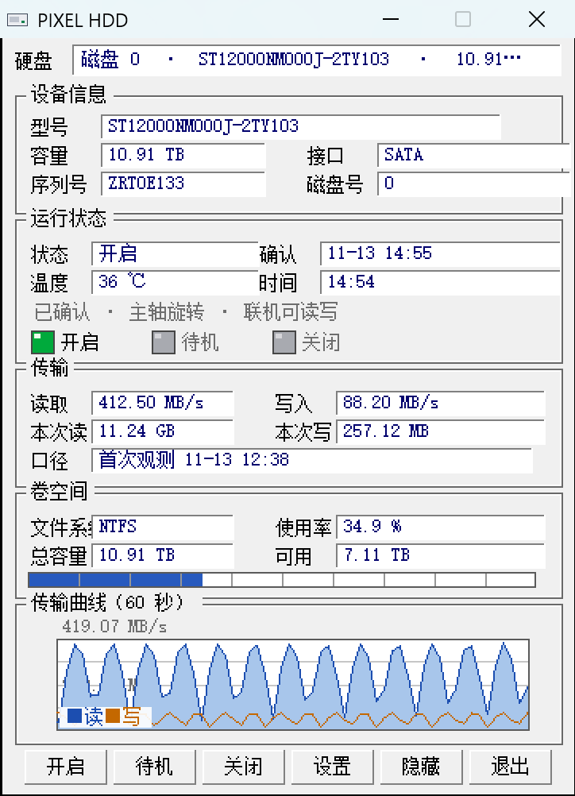

# PIXEL HDD

> 给长期挂着的大容量机械硬盘做电源控制、读写监控和容���统计的 Windows 小工具。
> 界面刻意做成 CPU-Z 那种老式工具软件的样子：系统灰底、凹陷数值栏、点阵字体、三色状态灯。



## 这个软件最初是干什么用的

起因很具体：机器里有一块 12 TB 的希捷 EXOS X18（`ST12000NM000J`，卷标挂在 `I:\`），平时用来存放视频和素材，绝大多数时间并不读写。但 Windows 不会因为「你不访问」就让机械盘停转——只要盘联机、磁头还在盘片上，它就一直转着、一直发热、一直有噪音，寿命也在消耗。

想手动管住它，常规做法都别扭：

- 设备管理器里「脱机」：能停用卷，但需要点好几层，而且盘可能仍在校准/旋转；
- 直接断电或拔线：危险，文件系统缓存没写回；
- 第三方 HDD 工具：偏测试用途，不是「常驻后台、一键待机/停转」的控制面板。

所以做了这个工具。核心目标只有一个：**在不丢数据的前提下，让这块不用的盘真正安静下来，需要时一键唤醒。** 监控（速度、温度、占用率）是为了知道「现在到底能不能关」以及「关掉之后状态对不对」，而不是为了跑分。

三个动作对应三种真实需求：

| 动作 | 对应状态 | 适用场景 |
| --- | --- | --- |
| **开启** | Active | 要用盘时，几十秒内恢复 `I:\` 访问 |
| **待机** | Idle_b | 短时间不用：磁头卸载，盘片继续转，有访问能立即醒 |
| **关闭** | Standby_z + 脱机 | 长时间不用：锁卷、写回缓存、脱机、主轴停转 |

## 功能

- **自动识别硬盘**：枚举本机所有支持 ATA 电源指令的硬盘（ATA / SATA / SAS / RAID 成员），排除系统盘、USB、SD 卡、虚拟盘和 NVMe。只有一块盘时自动选中；多块盘时出现下拉选择器。
- **实时监控**：每秒读取 Windows 物理磁盘原始计数，显示读写速度、本次启动累计读写；温度约 60 秒一次；卷使用率与方块/柱状占用条。
- **安全保护**（这是这个工具最花功夫的部分）：
  - 身份校验：序列号 + 磁盘 ID + 容量三项全对才允许发指令；
  - 系统盘保护：`IsBoot` / `IsSystem` 直接拒绝；
  - 分区布局复核：关闭前后核对分区数量与偏移，布局变了就阻止；
  - 分页文件检测：卷上带分页文件的直接拒绝；
  - 关闭前读写空闲检测：3 秒内计数有变化说明还有任务在读盘，拒绝关闭；
  - 失败自动回滚、崩溃后恢复记录：程序异常退出后重新打开，能知道上次关到哪一步。

## 界面

```
┌ 硬盘 [ 磁盘 0 · ST12000NM000J · 10.91 TB          ▼ ]┐
│ 设备信息   型号 / 容量 / 接口 / 序列号 / 磁盘号       │
│ 运行状态   状态 温度 确认 时间    ●开启 ○待机 ○关闭   │
│ 传输       读写速度 / 本次累计 / 计数口径             │
│ 卷空间     文件系统 总容量 可用 使用率 ▓▓▓▓░░░░░░░    │
│ 传输曲线（60 秒）  逐像素插值的读写曲线               │
│        [开启] [待机] [关闭] [设置] [隐藏] [退出]      │
└──────────────────────────────────────────────────────┘
```

界面按系统 DPI 整数倍放大：1× / 2× / 3× 下都是方正的像素字形，不会退化成平滑矢量；窗口放不下时会自动降一档。

## 构建

需要 Windows x64 与 .NET Framework 4.8（系统自带 `csc.exe`）。

1. 从 Seagate 官方 openSeaChest 发行包取得 `openSeaChest_PowerControl.exe` 和 `openSeaChest_SMART.exe`，放进 `tools/`。
2. 运行：

```powershell
powershell -ExecutionPolicy Bypass -File .\build.ps1
```

产物是 `PixelHdd.exe`（GUI）和 `TestRunner.exe`（测试）。运行需要管理员权限。

## 运行数据

全部写在 `%LOCALAPPDATA%\PixelHdd`：日志、计数、恢复记录、偏好设置。每个硬盘按序列号分开保存，多盘之间不会串。

## 已知限制

- 只对 ATA 电源管理（EPC）有效的硬盘生效；NVMe、USB 外置盘不在支持范围。
- 多盘自动识别已在单块 SATA 机械盘上实机验证；多盘同时控制尚未完整验证。
- 「关闭」前需要本机完成一次完整往返验证（`preferences.json` 中的 `OffValidated`），否则拒绝执行。
- 外部软件或设备仍可能唤醒主轴，界面显示的是最近一次实际查询结果。

## 许可

本项目代码以 MIT 许可发布，见 `LICENSE`。

内嵌的 openSeaChest 工具由 Seagate 提供，采用 Mozilla Public License 2.0，许可全文见 `Seagate-LICENSE.txt`。仓库不包含这些二进制文件，请从官方渠道获取。
